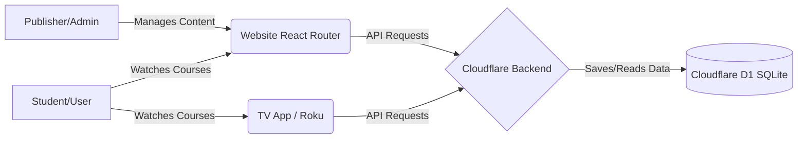

# Courses Project 🎓

This project encompasses a **Website**, a **Backend**, and a **Smart TV Application**. Its main goal is to provide a complete platform for distributing and consuming online courses.

## 🚀 Overview

- **Publishers**: Can access the website, manage channels, courses, and episodes, as well as determine which emails have access to each content.
- **Users/Students**: Through both the Website and the TV App, students can view available channels and courses for consumption.
- **Backend (Cloudflare)**: Responsible for managing all data access, resource validation (such as checking if the provided URLs contain images and videos in the correct sizes and formats), and user/admin authentication via Google OAuth.

---

## 🏗️ Architecture

The system works as follows:

### Directory Structure
- `/site` - Contains the website (admin panel and student view) and the backend served via Cloudflare Workers.
- `/tv` - Contains the application focused on Smart TVs.
- `/roku` - Reserved for the future Roku project.

## 📄 Tests
To check the implementation status of unit and integration tests, see:
- [Test Report (`test/README.en.md`)](./site/test/README.en.md)

## 🌐 Technologies
- **Frontend**: React Router, Tailwind CSS, Playwright (E2E Tests).
- **Backend**: Cloudflare Workers, Cloudflare D1 (SQLite), Vitest (Unit Tests).

## 💬 Languages
- [Portuguese (Brazil)](README.md)
- [English (Inglês)](README.en.md)
- [Spanish (Español)](README.es.md)
