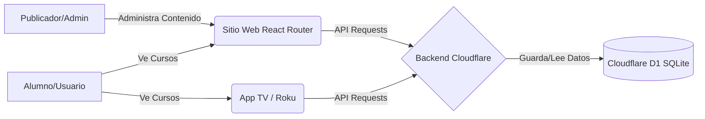

# Proyecto Cursos 🎓

Este proyecto abarca un **Sitio Web**, un **Backend** y una **Aplicación para Smart TVs**. Su objetivo principal es proporcionar una plataforma completa para la distribución y el consumo de cursos en línea.

## 🚀 Visión General

- **Publicadores**: Pueden acceder al sitio, administrar canales, cursos y episodios, así como determinar qué correos electrónicos tienen acceso a cada contenido.
- **Usuarios/Alumnos**: Tanto a través del Sitio como de la Aplicación de TV, los estudiantes pueden ver los canales y cursos disponibles para consumo.
- **Backend (Cloudflare)**: Responsable de administrar todo el acceso a los datos, validación de recursos (como verificar si las URLs proporcionadas contienen imágenes y videos en los tamaños y formatos correctos) y autenticación de usuarios y administradores a través de Google OAuth.

---

## 🏗️ Arquitectura

El sistema funciona de la siguiente manera:

### Estructura de Directorios
- `/site` - Contiene el sitio web (panel de administración y vista del estudiante) y el backend servido a través de Cloudflare Workers.
- `/tv` - Contiene la aplicación enfocada en Smart TVs.
- `/roku` - Reservado para el futuro proyecto Roku.

## 📄 Pruebas
Para verificar el estado de implementación de las pruebas unitarias y de integración, consulte:
- [Informe de Pruebas (`test/README.es.md`)](./site/test/README.es.md)

## 🌐 Tecnologías
- **Frontend**: React Router, Tailwind CSS, Playwright (Pruebas E2E).
- **Backend**: Cloudflare Workers, Cloudflare D1 (SQLite), Vitest (Pruebas Unitarias).

## 💬 Idiomas
- [Portugués (Brasil)](README.md)
- [Inglés (English)](README.en.md)
- [Español (Español)](README.es.md)
