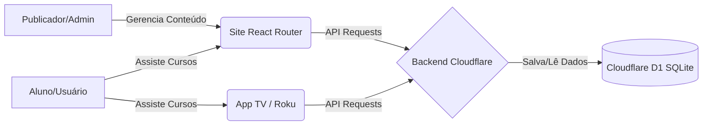

# Projeto Cursos 🎓

Este projeto engloba um **Site**, um **Backend** e um **Aplicativo para Smart TVs**. Seu principal objetivo é fornecer uma plataforma completa para a distribuição e consumo de cursos online.

## 🚀 Visão Geral

- **Publicadores**: Podem acessar o site, gerenciar canais, cursos e episódios, além de determinar quais e-mails têm acesso a cada conteúdo.
- **Usuários/Alunos**: Tanto pelo Site quanto pelo Aplicativo de TV, os alunos podem visualizar os canais e cursos disponíveis para consumo.
- **Backend (Cloudflare)**: Responsável por gerenciar todo o acesso aos dados, validação de recursos (como checar se as URLs informadas contêm imagens e vídeos nos tamanhos e formatos corretos) e autenticação de usuários e administradores via Google OAuth.

---

## 🏗️ Arquitetura

O sistema funciona da seguinte forma:

### Estrutura de Diretórios
- `/site` - Contém o site (painel de administração e visão do aluno) e o backend servido via Cloudflare Workers.
- `/tv` - Contém o aplicativo focado em Smart TVs.
- `/roku` - Reservado para o futuro projeto Roku.

## 📄 Testes
Para verificar o status das implementações de testes unitários e de integração, consulte:
- [Relatório de Testes (`test/README.md`)](./site/test/README.md)

## 🌐 Tecnologias
- **Frontend**: React Router, Tailwind CSS, Playwright (Testes E2E).
- **Backend**: Cloudflare Workers, Cloudflare D1 (SQLite), Vitest (Testes Unitários).

## 💬 Idiomas
- [Português (Brasil)](README.md)
- [Inglês (English)](README.en.md)
- [Espanhol (Español)](README.es.md)
