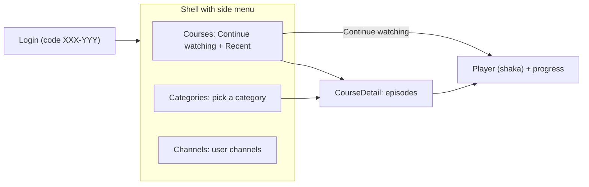

# Cursos TV (SolidTV)

A TV app for watching courses, built with the **SolidTV** framework (Canvas/WebGL rendering, remote-control navigation). It consumes the public API at `https://curso.ideias.casa`.

> Other languages: [Português](README.md) · [Español](README.es.md)

## Overview

The app has **three** items in the left side menu:

1. **Cursos** (Courses) — home screen with the "Continue watching" section (resumes episodes where you left off) and recently added courses, plus category shortcuts.
2. **Categorias** (Categories) — pick a category on the left and see its courses on the right (paginated, 10 per page).
3. **Canais** (Channels) — all channels available to your user.

Selecting a course opens its detail with the episode list; selecting an episode opens the **player** (shaka-player), which resumes from the saved progress, periodically saves progress, and on completion marks it as done and offers the next episode in the course.

## Architecture



Folder structure:

```
tv/
  public/fonts/        Roboto (TTF) fonts used by the Canvas text renderer
  src/
    index.tsx          Renderer, fonts, routes (HashRouter) and ErrorBoundary setup
    theme.ts           Colors and sizes (hex with alpha)
    fonts.ts           Font registration
    lib/
      api.ts           HTTP client (Authorization: Bearer <token>)
      store.ts         Token persisted in localStorage (signal)
      types.ts         API types
    components/
      Sidebar.tsx      Side menu with the 3 items
      Card.tsx         Course/channel card with focus and progress bar
      CardRow.tsx      Horizontal row of cards with a title
    pages/
      App.tsx          Focus manager (remote key map)
      Shell.tsx        1920x1080 layout (Sidebar + content) + login guard
      Login.tsx        On-screen keyboard to type the code
      Cursos.tsx       Home screen
      Categorias.tsx   Category list + course grid
      Canais.tsx       Channel grid
      CursoDetail.tsx  Episode list of a course
      Player.tsx       Video player (shaka-player)
```

## Requirements

- Node.js (see [.nvmrc](.nvmrc)). Run `nvm use` if you have nvm installed.
- pnpm.

## Running (development)

```bash
cd tv
nvm use           # optional, if you have nvm
pnpm install
pnpm start
```

Vite serves at `http://localhost:5174/`. Open it in the browser — navigation uses the **arrow keys** and **Enter** (emulating the remote). Use **Backspace** to go back.

## Signing in (login)

1. On another device (phone/computer), open `https://curso.ideias.casa/tv` and sign in with Google.
2. The page shows a code in the `XXX-YYY` format.
3. In the app, type that code on the on-screen keyboard and select **Entrar** (Enter).

The code is stored in `localStorage`. Generating a new code on the website invalidates the previous one.

## Configuration

The API URL is configurable via the `VITE_API_BASE` environment variable (see [.env](.env)):

```
VITE_API_BASE=https://curso.ideias.casa
```

## Production build

```bash
pnpm build      # outputs to dist/
pnpm preview    # serves the build locally
```

## Controls (remote / keyboard)

| Action | Key |
| --- | --- |
| Navigate | Arrows (↑ ↓ ← →) |
| Select | Enter |
| Back | Backspace |
| Play/Pause (in player) | Enter / PlayPause |

## Technical notes

- Text is rendered by the **CanvasTextRenderer** using TTF fonts (Roboto), ensuring full coverage of Portuguese accents. The demo's MSDF atlases only cover basic ASCII and would break characters like `ç`, `ã`, `ó`.
- The only auth state is the Bearer token; the app is read-only except for saving progress (`POST /api/v1/tv/progresso`).
- Loading errors are handled per page (with `ErrorBoundary`) so the side menu stays usable.
