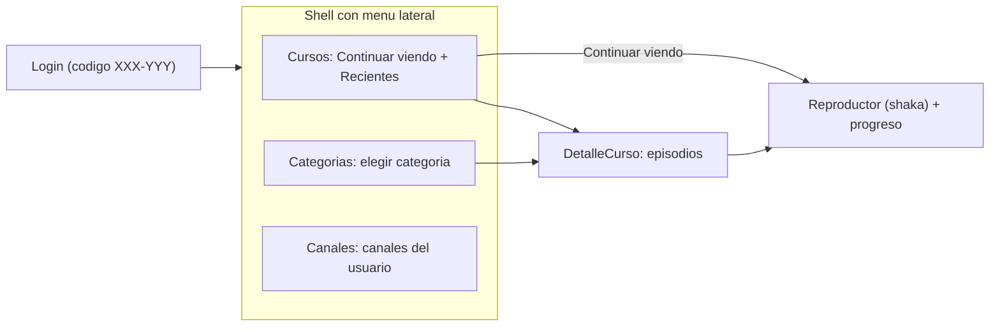

# Cursos TV (SolidTV)

Aplicación de TV para ver cursos, construida con el framework **SolidTV** (renderizado sobre Canvas/WebGL, navegación por control remoto). Consume la API pública en `https://curso.ideias.casa`.

> Otros idiomas: [Português](README.md) · [English](README.en.md)

## Resumen

La app tiene **tres** elementos en el menú lateral izquierdo:

1. **Cursos** — pantalla inicial con la sección "Continuar viendo" (retoma los episodios donde los dejaste) y los cursos agregados recientemente, además de accesos a categorías.
2. **Categorias** (Categorías) — elige una categoría a la izquierda y ve sus cursos a la derecha (paginación de 10 en 10).
3. **Canais** (Canales) — todos los canales disponibles para tu usuario.

Al elegir un curso se abre su detalle con la lista de episodios; al elegir un episodio se abre el **reproductor** (shaka-player), que retoma desde el progreso guardado, guarda el progreso periódicamente y, al terminar, lo marca como completado y ofrece el siguiente episodio del curso.

## Arquitectura



Estructura de carpetas:

```
tv/
  public/fonts/        Fuentes Roboto (TTF) usadas por el renderizador de texto Canvas
  src/
    index.tsx          Inicializacion del renderer, fuentes, rutas (HashRouter) y ErrorBoundary
    theme.ts           Colores y medidas (hex con alfa)
    fonts.ts           Registro de fuentes
    lib/
      api.ts           Cliente HTTP (Authorization: Bearer <token>)
      store.ts         Token persistido en localStorage (signal)
      types.ts         Tipos de la API
    components/
      Sidebar.tsx      Menu lateral con los 3 elementos
      Card.tsx         Tarjeta de curso/canal con foco y barra de progreso
      CardRow.tsx      Fila horizontal de tarjetas con titulo
    pages/
      App.tsx          Focus manager (mapa de teclas del control)
      Shell.tsx        Layout 1920x1080 (Sidebar + contenido) + guardia de login
      Login.tsx        Teclado en pantalla para escribir el codigo
      Cursos.tsx       Pantalla inicial
      Categorias.tsx   Lista de categorias + grilla de cursos
      Canais.tsx       Grilla de canales
      CursoDetail.tsx  Lista de episodios de un curso
      Player.tsx       Reproductor de video (shaka-player)
```

## Requisitos

- Node.js (ver [.nvmrc](.nvmrc)). Ejecuta `nvm use` si tienes nvm instalado.
- pnpm.

## Cómo ejecutar (desarrollo)

```bash
cd tv
nvm use           # opcional, si tienes nvm
pnpm install
pnpm start
```

Vite levanta en `http://localhost:5174/`. Ábrelo en el navegador — la navegación usa las **flechas del teclado** y **Enter** (emulando el control remoto). Usa **Backspace** para volver.

## Cómo iniciar sesión (login)

1. En otro dispositivo (celular/computadora), entra a `https://curso.ideias.casa/tv` e inicia sesión con Google.
2. La página muestra un código con el formato `XXX-YYY`.
3. En la app, escribe ese código en el teclado en pantalla y selecciona **Entrar**.

El código queda guardado en `localStorage`. Generar un nuevo código en el sitio invalida el anterior.

## Configuración

La URL de la API es configurable con la variable de entorno `VITE_API_BASE` (ver [.env](.env)):

```
VITE_API_BASE=https://curso.ideias.casa
```

## Build de producción

```bash
pnpm build      # genera dist/
pnpm preview    # sirve el build localmente
```

## Controles (control remoto / teclado)

| Acción | Tecla |
| --- | --- |
| Navegar | Flechas (↑ ↓ ← →) |
| Seleccionar | Enter |
| Volver | Backspace |
| Play/Pausa (en el reproductor) | Enter / PlayPause |

## Notas técnicas

- El texto se renderiza con el **CanvasTextRenderer** usando fuentes TTF (Roboto), asegurando cobertura completa de los acentos del portugués/español. Los atlas MSDF del demo solo cubren ASCII básico y romperían caracteres como `ç`, `ã`, `ó`, `ñ`.
- El único estado de autenticación es el token Bearer; la app es de solo lectura, excepto al guardar el progreso (`POST /api/v1/tv/progresso`).
- Los errores de carga se manejan por página (con `ErrorBoundary`) para que el menú lateral siga siendo utilizable.
