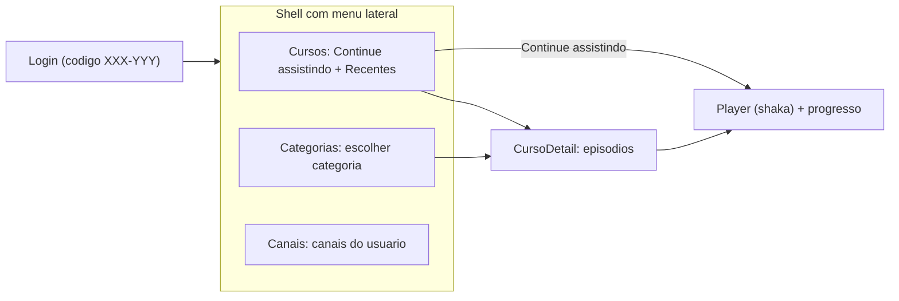

# Cursos TV (SolidTV)

Aplicativo de TV para assistir cursos, construído com o framework **SolidTV** (renderização sobre Canvas/WebGL, navegação por controle remoto). Consome a API pública em `https://curso.ideias.casa`.

> Documentação em outros idiomas: [English](README.en.md) · [Español](README.es.md)

## Visão geral

O app tem **três itens** no menu lateral esquerdo:

1. **Cursos** — tela inicial com a seção "Continue assistindo" (retoma os episódios de onde você parou) e os cursos adicionados recentemente, além de atalhos de categorias.
2. **Categorias** — escolha uma categoria à esquerda e veja os cursos dela à direita (paginação de 10 em 10).
3. **Canais** — todos os canais disponíveis para o seu usuário.

Ao escolher um curso, abre-se o detalhe com a lista de episódios; ao escolher um episódio, o **player** (shaka-player) reproduz o vídeo, retoma do progresso salvo, grava o progresso periodicamente e, ao terminar, marca como concluído e oferece o próximo episódio do curso.

## Arquitetura



Estrutura de pastas:

```
tv/
  public/fonts/        Fontes Roboto (TTF) usadas pelo renderizador de texto via Canvas
  src/
    index.tsx          Inicializacao do renderer, fontes, rotas (HashRouter) e ErrorBoundary
    theme.ts           Cores e medidas (hex com alpha)
    fonts.ts           Registro das fontes
    lib/
      api.ts           Cliente HTTP (Authorization: Bearer <token>)
      store.ts         Token persistido em localStorage (signal)
      types.ts         Tipos da API
    components/
      Sidebar.tsx      Menu lateral com os 3 itens
      Card.tsx         Card de curso/canal com foco e barra de progresso
      CardRow.tsx      Linha horizontal de cards com titulo
    pages/
      App.tsx          Focus manager (mapa de teclas do controle)
      Shell.tsx        Layout 1920x1080 (Sidebar + conteudo) + guarda de login
      Login.tsx        Teclado on-screen para digitar o codigo
      Cursos.tsx       Tela inicial
      Categorias.tsx   Lista de categorias + grade de cursos
      Canais.tsx       Grade de canais
      CursoDetail.tsx  Lista de episodios de um curso
      Player.tsx       Player de video (shaka-player)
```

## Requisitos

- Node.js (veja [.nvmrc](.nvmrc)). Use `nvm use` se tiver o nvm instalado.
- pnpm.

## Como rodar (desenvolvimento)

```bash
cd tv
nvm use           # opcional, se houver nvm
pnpm install
pnpm start
```

O Vite sobe em `http://localhost:5174/`. Abra no navegador — a navegação é feita pelas **setas do teclado** e **Enter** (simulando o controle remoto). Use **Backspace** para voltar.

## Como entrar (login)

1. Em outro dispositivo (celular/computador), acesse `https://curso.ideias.casa/tv` e faça login com o Google.
2. A página mostra um código no formato `XXX-YYY`.
3. No app, digite esse código no teclado on-screen e selecione **Entrar**.

O código fica salvo no `localStorage`. Gerar um novo código no site invalida o anterior.

## Configuração

A URL da API é configurável pela variável de ambiente `VITE_API_BASE` (ver [.env](.env)):

```
VITE_API_BASE=https://curso.ideias.casa
```

## Build de produção

```bash
pnpm build      # gera dist/
pnpm preview    # serve o build localmente
```

## Controles (controle remoto / teclado)

| Ação | Tecla |
| --- | --- |
| Navegar | Setas (↑ ↓ ← →) |
| Selecionar | Enter |
| Voltar | Backspace |
| Play/Pause (no player) | Enter / PlayPause |

## Notas técnicas

- O texto é renderizado pelo **CanvasTextRenderer** com fontes TTF (Roboto), garantindo cobertura completa dos acentos do português. Os atlas MSDF do demo cobrem apenas ASCII básico e quebrariam caracteres como `ç`, `ã`, `ó`.
- Todo o estado de autenticação é apenas o token Bearer; o app é somente-leitura, exceto a gravação de progresso (`POST /api/v1/tv/progresso`).
- Erros de carregamento são tratados por página (com `ErrorBoundary`) para que o menu lateral continue utilizável.
