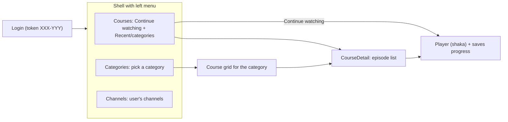

# Plan — TV App (SolidTV): Courses, Categories, Channels

> Implementation planning document for the TV app. Versions: [PLANO.md](PLANO.md) (pt-BR) · [PLANO.en.md](PLANO.en.md) (en) · [PLANO.es.md](PLANO.es.md) (es).

## Context

The backend is complete and deployed at `curso.ideias.casa`. No backend changes were needed:

- TV API under `api/v1/tv/*`: `home`, `canais`, `categorias`, `cursos`, `episodios/:id_curso`, `progresso`.
- Authentication via `XXX-YYY` (Bearer) token obtained on the `/tv` page after Google login.
- `Categoria` / `CursoCategoria` tables, `data_publicacao` field on `Curso`/`Episodio`, and the global category CRUD in the panel are already implemented.

The app was built from scratch in the `tv/` directory, following the `AI_CODING_GUIDELINES.md` framework and the `solid-demo-app` patterns.

## Consumed API contract

- `GET /api/v1/tv/home` → `{ continue_watching[], recent_courses[], canais[], categorias[] }`
- `GET /api/v1/tv/categorias` → `{ categorias[] }`
- `GET /api/v1/tv/cursos?categoria=<id>&page=<n>` → `{ cursos[], page, limit }` (10/page)
- `GET /api/v1/tv/episodios/:id_curso` → `{ episodios[] }` (with `progresso`, `concluido`, `url`, `media_type`)
- `GET /api/v1/tv/canais` → `{ canais[] }`
- `GET/POST /api/v1/tv/progresso` → read/write `{ id_episodio, progresso, concluido }`

## Navigation flow



## Decisions made

- Fully functional player with shaka-player (HLS/MP4) over the canvas, saving progress periodically and marking `concluido` on finish.
- App points to `https://curso.ideias.casa` (configurable via `VITE_API_BASE` in `tv/.env`).
- Lean, custom app reusing the demo patterns (not copying the ~60 example pages).
- Text rendering via `CanvasTextRenderer` + TTF fonts, because the demo's MSDF atlases only cover ASCII and would break Portuguese accents.

## Implementation steps

1. **Scaffolding**: `package.json`, `vite.config.js`, `tsconfig.json`, `index.html`, `styles.css`, `.env`, `.nvmrc`, `pnpm-workspace.yaml` and Roboto fonts in `public/fonts`.
2. **Entry and shell**: `src/index.tsx` (renderer + router), `theme.ts`, `fonts.ts`, `pages/App.tsx` (focus manager), `components/Sidebar.tsx` (3 items), `pages/Shell.tsx`.
3. **Auth and data**: `lib/api.ts` (Bearer + `VITE_API_BASE`), `lib/store.ts` (token in `localStorage`), `pages/Login.tsx` (on-screen keyboard).
4. **3 screens**: `pages/Cursos.tsx`, `pages/Categorias.tsx`, `pages/Canais.tsx`.
5. **Detail + Player**: `pages/CursoDetail.tsx` and `pages/Player.tsx` (shaka, resume progress, periodic POST, mark completed, next episode).
6. **Docs and verification**: READMEs (pt/en/es), `AGENTS.md` summary update, and a browser smoke test.

## How to test

```bash
cd tv
pnpm install
pnpm start
```

Opens the app in the browser (canvas, keyboard-arrow navigation). Generate a token at `https://curso.ideias.casa/tv` (Google login) and type it on the app's login screen — without reloading the page afterwards, since the token is one-per-user and each new one replaces the previous.

## Backend deploy (if needed)

The backend is already deployed. If you need to republish, from the `site` directory:

```bash
cd site
pnpm run build
pnpm run deploy
```
