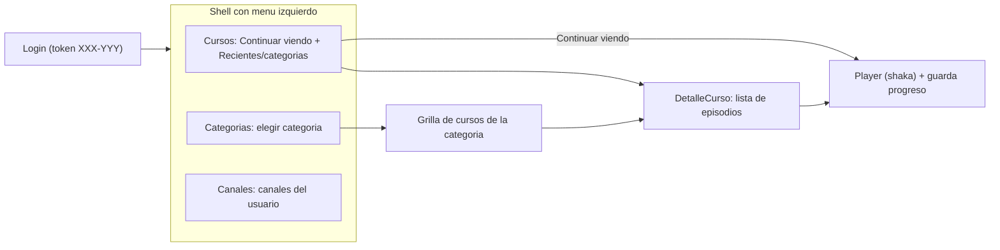

# Plan — App de TV (SolidTV): Cursos, Categorías, Canales

> Documento de planificación de la implementación de la app de TV. Versiones: [PLANO.md](PLANO.md) (pt-BR) · [PLANO.en.md](PLANO.en.md) (en) · [PLANO.es.md](PLANO.es.md) (es).

## Contexto

El backend está completo y publicado en `curso.ideias.casa`. No fue necesario cambiar nada del backend:

- API de TV en `api/v1/tv/*`: `home`, `canais`, `categorias`, `cursos`, `episodios/:id_curso`, `progresso`.
- Autenticación por token `XXX-YYY` (Bearer), obtenido en la página `/tv` tras el login con Google.
- Tablas `Categoria` / `CursoCategoria`, campo `data_publicacao` en `Curso`/`Episodio` y el CRUD global de categorías en el panel ya implementados.

La app se creó desde cero en el directorio `tv/`, siguiendo el framework de `AI_CODING_GUIDELINES.md` y los patrones de `solid-demo-app`.

## Contrato de la API consumida

- `GET /api/v1/tv/home` → `{ continue_watching[], recent_courses[], canais[], categorias[] }`
- `GET /api/v1/tv/categorias` → `{ categorias[] }`
- `GET /api/v1/tv/cursos?categoria=<id>&page=<n>` → `{ cursos[], page, limit }` (10/página)
- `GET /api/v1/tv/episodios/:id_curso` → `{ episodios[] }` (con `progresso`, `concluido`, `url`, `media_type`)
- `GET /api/v1/tv/canais` → `{ canais[] }`
- `GET/POST /api/v1/tv/progresso` → leer/guardar `{ id_episodio, progresso, concluido }`

## Flujo de navegación



## Decisiones tomadas

- Reproductor totalmente funcional con shaka-player (HLS/MP4) sobre el canvas, guardando el progreso periódicamente y marcando `concluido` al terminar.
- La app apunta a `https://curso.ideias.casa` (configurable vía `VITE_API_BASE` en `tv/.env`).
- App ligera y propia, reutilizando los patrones del demo (sin copiar las ~60 páginas de ejemplo).
- Renderizado de texto vía `CanvasTextRenderer` + fuentes TTF, porque los atlas MSDF del demo solo cubren ASCII y romperían los acentos del portugués.

## Pasos de implementación

1. **Scaffolding**: `package.json`, `vite.config.js`, `tsconfig.json`, `index.html`, `styles.css`, `.env`, `.nvmrc`, `pnpm-workspace.yaml` y fuentes Roboto en `public/fonts`.
2. **Entrada y shell**: `src/index.tsx` (renderer + router), `theme.ts`, `fonts.ts`, `pages/App.tsx` (focus manager), `components/Sidebar.tsx` (3 ítems), `pages/Shell.tsx`.
3. **Auth y datos**: `lib/api.ts` (Bearer + `VITE_API_BASE`), `lib/store.ts` (token en `localStorage`), `pages/Login.tsx` (teclado en pantalla).
4. **3 pantallas**: `pages/Cursos.tsx`, `pages/Categorias.tsx`, `pages/Canais.tsx`.
5. **Detalle + Player**: `pages/CursoDetail.tsx` y `pages/Player.tsx` (shaka, reanudar progreso, POST periódico, marcar concluido, siguiente episodio).
6. **Documentación y verificación**: READMEs (pt/en/es), actualización del resumen de `AGENTS.md` y prueba de humo en el navegador.

## Cómo probar

```bash
cd tv
pnpm install
pnpm start
```

Abre la app en el navegador (canvas, navegación con flechas del teclado). Genera un token en `https://curso.ideias.casa/tv` (login con Google) y escríbelo en la pantalla de login de la app — sin recargar la página después, ya que el token es único por usuario y cada nuevo reemplaza al anterior.

## Despliegue del backend (si es necesario)

El backend ya está publicado. Si necesitas republicar, desde el directorio `site`:

```bash
cd site
pnpm run build
pnpm run deploy
```
