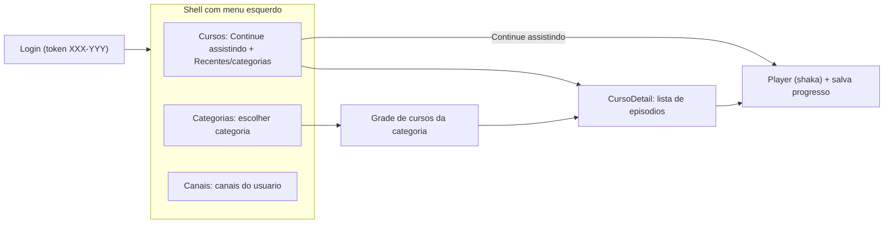

# Plano — App de TV (SolidTV): Cursos, Categorias, Canais

> Documento de planejamento da implementação do app de TV. Versões: [PLANO.md](PLANO.md) (pt-BR) · [PLANO.en.md](PLANO.en.md) (en) · [PLANO.es.md](PLANO.es.md) (es).

## Contexto

O backend está completo e publicado em `curso.ideias.casa`. Nada de backend precisou mudar:

- API de TV em `api/v1/tv/*`: `home`, `canais`, `categorias`, `cursos`, `episodios/:id_curso`, `progresso`.
- Autenticação por token `XXX-YYY` (Bearer), obtido na página `/tv` após login Google.
- Tabelas `Categoria` / `CursoCategoria`, campo `data_publicacao` em `Curso`/`Episodio` e CRUD global de categorias no painel já implementados.

O app foi criado do zero no diretório `tv/`, seguindo o framework do `AI_CODING_GUIDELINES.md` e os padrões do `solid-demo-app`.

## Contrato da API consumida

- `GET /api/v1/tv/home` → `{ continue_watching[], recent_courses[], canais[], categorias[] }`
- `GET /api/v1/tv/categorias` → `{ categorias[] }`
- `GET /api/v1/tv/cursos?categoria=<id>&page=<n>` → `{ cursos[], page, limit }` (10/página)
- `GET /api/v1/tv/episodios/:id_curso` → `{ episodios[] }` (com `progresso`, `concluido`, `url`, `media_type`)
- `GET /api/v1/tv/canais` → `{ canais[] }`
- `GET/POST /api/v1/tv/progresso` → ler/gravar `{ id_episodio, progresso, concluido }`

## Fluxo de navegação



## Decisões tomadas

- Player funcional completo com shaka-player (HLS/MP4) sobre o canvas, salvando progresso periodicamente e marcando `concluido` ao terminar.
- App aponta para `https://curso.ideias.casa` (configurável via `VITE_API_BASE` em `tv/.env`).
- App enxuto e próprio, reaproveitando os padrões do demo (sem copiar as ~60 páginas de exemplo).
- Renderização de texto via `CanvasTextRenderer` + fontes TTF, porque os atlas MSDF do demo cobrem apenas ASCII e quebrariam os acentos do português.

## Etapas de implementação

1. **Scaffolding**: `package.json`, `vite.config.js`, `tsconfig.json`, `index.html`, `styles.css`, `.env`, `.nvmrc`, `pnpm-workspace.yaml` e fontes Roboto em `public/fonts`.
2. **Entrada e shell**: `src/index.tsx` (renderer + router), `theme.ts`, `fonts.ts`, `pages/App.tsx` (focus manager), `components/Sidebar.tsx` (3 itens), `pages/Shell.tsx`.
3. **Auth e dados**: `lib/api.ts` (Bearer + `VITE_API_BASE`), `lib/store.ts` (token em `localStorage`), `pages/Login.tsx` (teclado on-screen).
4. **3 telas**: `pages/Cursos.tsx`, `pages/Categorias.tsx`, `pages/Canais.tsx`.
5. **Detalhe + Player**: `pages/CursoDetail.tsx` e `pages/Player.tsx` (shaka, retomar progresso, POST periódico, marcar concluído, próximo episódio).
6. **Documentação e verificação**: READMEs (pt/en/es), atualização do resumo do `AGENTS.md` e smoke test no navegador.

## Como testar

```bash
cd tv
pnpm install
pnpm start
```

Abre o app no navegador (canvas, navegação por setas do teclado). Gere um token em `https://curso.ideias.casa/tv` (login Google) e digite-o na tela de login do app — sem recarregar a página depois de gerar, pois o token é único por usuário e cada novo gera/invalida o anterior.

## Deploy do backend (se necessário)

O backend já está publicado. Caso precise republicar, no diretório `site`:

```bash
cd site
pnpm run build
pnpm run deploy
```
